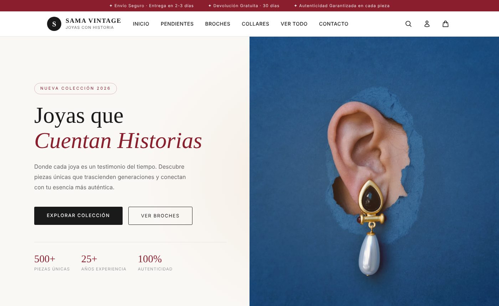
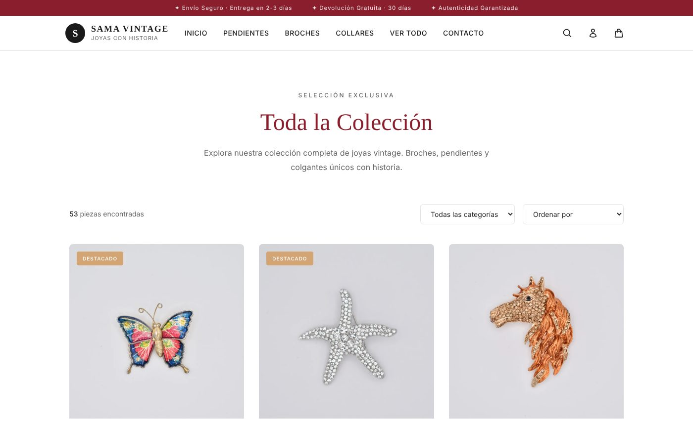
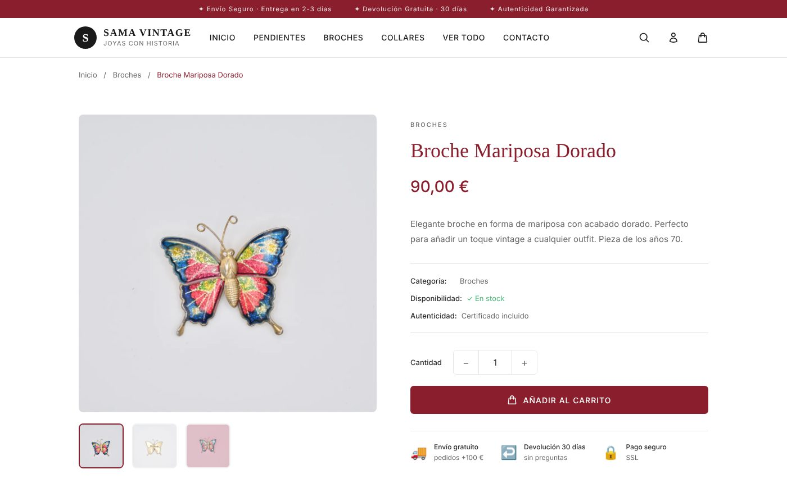
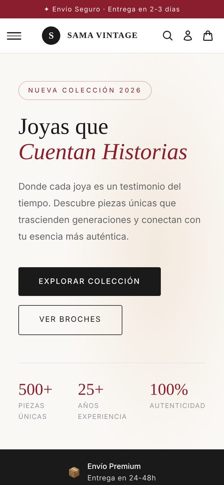

<div align="center">
  
</div>

<div align="center">
  <a href="https://github.com/evagr11/sama-vintage" target="_blank"></a>
  <a href="https://evagr11.github.io/sama-vintage/" target="_blank"></a>
</div>

<br>

<div align="center">
  <a href="https://git.io/typing-svg"></a>
</div>

# 🌸 Sobre el Proyecto

**Sama Vintage** es un **sitio web estático de joyería vintage**: el rediseño completo de una tienda real, con catálogo de **53 piezas**, ficha de producto, carrito y checkout. Está hecho **sin frameworks**, solo con HTML, CSS y JavaScript, y se publica gratis en GitHub Pages.

<div align="center">
  
  <p><em>Portada de la tienda</em></p>
</div>

✨ **Características principales:**

*   💍 **Catálogo de 53 piezas** en tres categorías (broches, pendientes y collares), con filtro por categoría y ordenación.
*   📄 **Una sola plantilla para todos los productos:** la ficha lee el parámetro `?id=` de la URL y pinta los datos y la galería de fotos desde `data.js`.
*   🧺 **Carrito persistente** con `localStorage`: añadir, quitar, cambiar cantidades y total actualizado, con el contador del icono sincronizado en todas las páginas.
*   📱 **Responsive** con menú hamburguesa en móvil.
*   ⚡ **Imágenes optimizadas** en WebP con carga diferida (`loading="lazy"`): todo el catálogo pesa menos de 10 MB.

### Galería

| Toda la colección | Ficha de producto |
| :---------------: | :---------------: |
|  |  |
| *Filtro por categoría y ordenación.* | *Galería de fotos, cantidad y añadir al carrito.* |

<div align="center">
  
  <p><em>Versión móvil</em></p>
</div>

# 🧠 Contexto del Proyecto

Este proyecto surge como parte del módulo **SGE (Sistemas de Gestión Empresarial)** del segundo curso de **DAM**.

El objetivo era realizar el **rebranding completo de una web real existente**:  
**Sama Vintage**, una tienda de joyería vintage.

El proyecto original se desarrolló en **WordPress**, pero después decidí **rehacerlo desde cero como sitio estático** para conservarlo en GitHub sin depender de un CMS, mostrar la implementación frontend pura y mantenerlo en mi portfolio. Este repositorio es esa **versión reconstruida**.

# 👥 Proyecto Original (WordPress)

La primera versión se hizo en equipo junto a:

<div align="center">
  <a href="https://github.com/AnaNunezRejon" target="_blank">
    
  </a>
  <a href="https://github.com/Anyeel" target="_blank">
    
  </a>
</div>

Trabajamos de forma colaborativa tanto en el **diseño**, el **prototipado** y la **implementación del sitio en WordPress**.

### ⚙️ Plugins utilizados

Para implementar funcionalidades en WordPress se utilizaron varios plugins:

- **Code Snippets**
- **Contact Form 7**
- **Disable Gutenberg**
- **Simple Custom CSS and JS**
- **WooCommerce**

# 🛠️ Tecnologías

<p align="center">


</p>

# 🎨 Proceso de Diseño

El proyecto no solo incluye desarrollo web, sino también el **proceso completo de diseño UI/UX**.

### 📖 Guía de estilos

Se diseñó una **guía de estilos completa en Canva**, donde se definieron:

- Paleta de colores (granate, dorado y crema)
- Tipografías
- Estética visual de la marca
- Componentes de interfaz

### 🧩 Prototipado

Los prototipos de la web fueron diseñados en **Figma**, incluyendo:

- Wireframes iniciales
- Prototipos de navegación
- Diseño responsive

Esto permitió definir la experiencia de usuario antes de implementar el código.

### 💻 Implementación

Finalmente, la web fue implementada en dos fases:

1️⃣ **Versión original en WordPress** (proyecto académico)  
2️⃣ **Reconstrucción en HTML/CSS/JS puro** para esta versión del repositorio

---

# 🧩 Arquitectura del Proyecto

```bash
sama-vintage/
│
├── index.html
│
├── assets/
│   ├── css/              # base.css + un archivo por sección o página
│   ├── js/
│   │   ├── data.js       # Catálogo de productos, carrito y funciones comunes
│   │   └── header.js     # Menú responsive y buscador
│   └── images/           # Fotos de producto en WebP
│
└── templates/
    ├── producto.html
    ├── carrito.html
    ├── tienda.html
    ├── broches.html
    ├── pendientes.html
    ├── collares.html
    ├── contacto.html
    ├── checkout.html
    ├── terminos.html
    ├── privacidad.html
    └── cuenta/
        └── perfil.html
```

# 🛒 Funcionalidades

### 🛍️ Catálogo de productos
- Visualización de todos los artículos disponibles
- Organización por categorías (broches, pendientes, collares)
- Navegación simple y clara

### 📄 Página de producto
- Cada producto tiene su **vista detallada**
- Los datos se cargan dinámicamente leyendo el parámetro `?id=` de la URL
- Reutilización de la misma plantilla para todos los productos

### 🧺 Carrito persistente
- Añadir y eliminar productos
- Actualización automática del total
- Guardado en **localStorage**
- Persistencia entre páginas y recargas
- Checkout con resumen del pedido (simulado, sin pago real)

### 📱 Diseño responsive
- Navegación adaptable
- Menú responsive controlado con JavaScript
- Compatible con móvil, tablet y escritorio

# 🚀 Cómo Utilizar el Proyecto

### 1. Verlo online

**[evagr11.github.io/sama-vintage](https://evagr11.github.io/sama-vintage/)**

### 2. Probarlo en local

1.  Clona el repositorio:
    ```bash
    git clone https://github.com/evagr11/sama-vintage.git
    ```
2.  Navega a la carpeta del proyecto:
    ```bash
    cd sama-vintage
    ```
3.  Abre `index.html` en el navegador, o levanta un servidor con `python -m http.server` y entra en `http://localhost:8000`.

# 📚 Lo que aprendí con este proyecto

- Organización de proyectos **frontend sin frameworks**
- Manipulación del **DOM con JavaScript vanilla**
- Persistencia de datos usando **localStorage**
- Arquitectura de páginas reutilizables
- Deploy automático con **GitHub Pages**
- Optimizar imágenes para la web (de 171 MB en PNG a menos de 10 MB en WebP)

# 🎯 Mejoras futuras

- 🔎 Sistema de búsqueda de productos  
- 🎨 Animaciones UI y microinteracciones  
- 🛍️ Integración con backend real  
- 💳 Checkout funcional

<br>

<div align="center">
  <p>Creado por <strong>Eva Gallardo</strong></p>
  <a href="https://github.com/evagr11" target="_blank">
    
  </a>
  <a href="https://www.linkedin.com/in/eva-gallardo-romero-830362349/" target="_blank">
    
  </a>
</div>

<div align="center">
  
</div>
